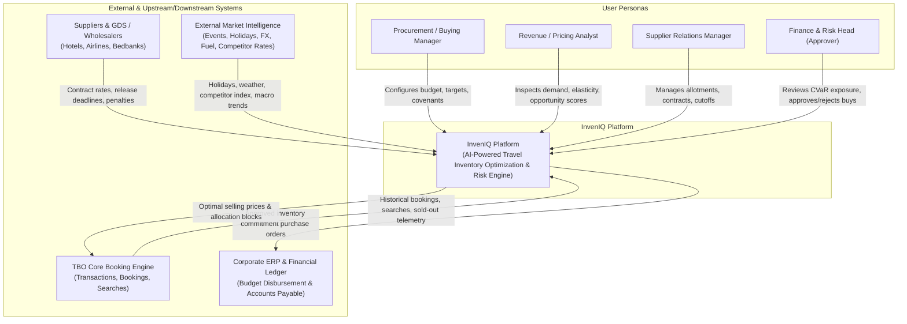
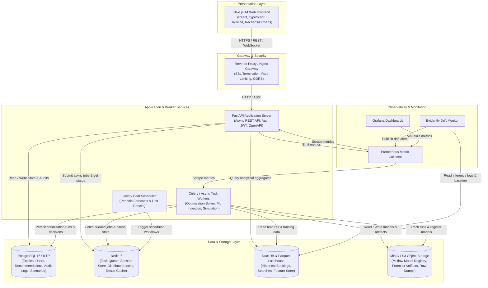
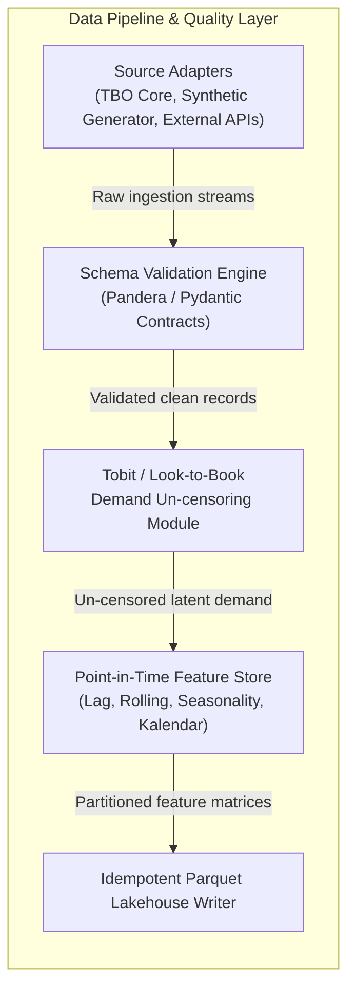
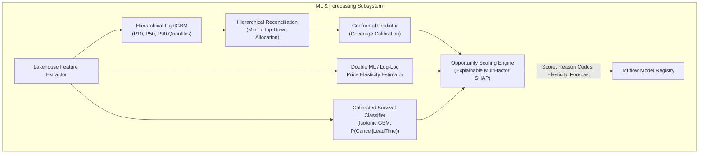
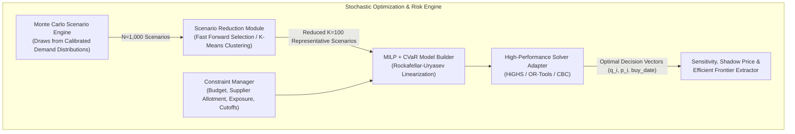

# InvenIQ: System Architecture Documentation (C4 Specification)

## 1. System Context Diagram (C4 Level 1)
InvenIQ sits at the center of TBO.com's procurement, pricing, and risk management operations. It connects internal decision-makers with upstream supplier terms, downstream core booking distribution, and external market signals.



---

## 2. Container Diagram (C4 Level 2)
The container architecture implements a high-throughput, decoupled micro-service and pipeline topology.



---

## 3. Component Diagrams (C4 Level 3)

### 3.1 Data & Ingestion Pipeline Component Diagram


### 3.2 Machine Learning & Opportunity Scoring Component Diagram


### 3.3 Stochastic Optimization & Risk Engine Component Diagram


---

## 4. End-to-End Sequence Diagram
Demonstrates how a Procurement Manager triggers an optimization run, how the async pipeline computes the decision, how risk checks are applied, and how the Finance Head approves the purchase commitment.

```mermaid
sequenceDiagram
    autonumber
    actor Buyer as Procurement Manager
    actor Finance as Finance / Risk Head
    participant Web as Web Frontend (Next.js)
    participant API as FastAPI Gateway
    participant Redis as Redis Queue / Cache
    participant Worker as Celery Worker
    participant ML as ML & Feature Engine
    participant Opt as Stochastic Optimizer (MILP+CVaR)
    participant DB as PostgreSQL DB
    participant ERP as TBO Core / ERP

    Buyer->>Web: Configure Run (Budget: ₹5 Cr, Risk: Balanced, Caps)
    Web->>API: POST /api/v1/optimization/runs (with Idempotency-Key)
    API->>DB: Record Run State (Status = PENDING)
    API->>Redis: Enqueue Job (run_id, params)
    API-->>Web: 202 Accepted (run_id, status: PENDING)

    Worker->>Redis: Dequeue Job (run_id)
    Worker->>DB: Update Run State (Status = IN_PROGRESS)
    Worker->>ML: Fetch Calibrated Forecasts, Elasticity & Cancellation Curves
    ML-->>Worker: Quantiles (P10/P50/P90), E[Demand], Elasticity, Cancel Probabilities
    Worker->>Opt: Build Stochastic Scenarios & Solve MILP + CVaR
    Opt-->>Worker: Solution (Optimal q_i, p_i, Timing, E[Profit], CVaR, Shadow Prices)
    Worker->>DB: Persist Recommendations, Frontier & Explainability Metrics
    Worker->>DB: Update Run State (Status = COMPLETED_AWAITING_APPROVAL)
    Worker->>Redis: Publish Run Finished Event

    Web->>API: GET /api/v1/optimization/runs/{id} (Poll / SSE)
    API-->>Web: Run Completed, Recommendations & Risk Frontier Available
    Buyer->>Web: Review Recommendations, Sunburst & Efficient Frontier
    Buyer->>Web: Submit for Financial Review

    Finance->>Web: Inspect CVaR Downside, Worst-Case Scenarios & Sensitivity
    Finance->>Web: Click "Approve Purchase Commitment"
    Web->>API: POST /api/v1/optimization/runs/{id}/approve (JWT Auth)
    API->>DB: Record Audit Log (Approver, Timestamp, Rationale)
    API->>DB: Transition Run State (Status = APPROVED)
    API->>ERP: Dispatch Purchase Commitment Orders & Dynamic Price Rules
    ERP-->>API: 200 OK (Orders Acknowledged)
    API-->>Web: Approval Confirmed & Dispatched
```
